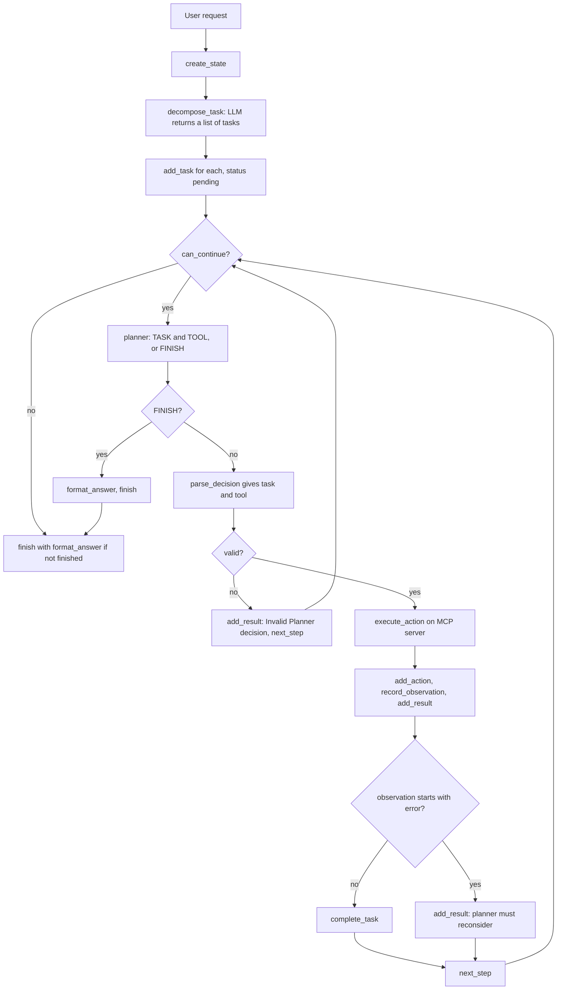

# Day 10: Task Planning (Decompose First, Then Execute)

**Theme:** before acting, the agent breaks the request into an ordered **task list**. The planner then works through the tasks one at a time, picking a tool for each.

## 1. Pitch

> "On day 10 I added a task planner. A separate LLM call decomposes the user's request into short tasks, which are stored in the state with a `pending` or `completed` status. Each loop iteration the planner picks one pending task and the best tool, replying in a strict `TASK:` / `TOOL:` format that the loop parses. A task is only marked complete if the tool did not return an error, so failures trigger a re-plan."

## Architecture and Workflow

### Architecture

```
┌──────────────────────────────── AGENT PROCESS ────────────────────────────────┐   ┌─ MCP SERVER ─┐
│ runner.py ─► loop.run_agent_loop()                                             │   │ server.py    │
│                 │                                                              │   │ 3 tools      │
│   LEVEL 1       ├─► task_planner.decompose_task()  ─► LLM ─► ["task1","task2"] │   └──────▲───────┘
│   (what?)       │                                                              │          │
│                 ▼                                                              │          │
│            state.py  { tasks:[{task,status}], actions, observations, results } │          │
│                 ▲  ▲                                                           │          │
│   LEVEL 2       │  └── planner.planner() ─► LLM ─► "TASK: .. / TOOL: .." | FINISH         │
│   (how?)        │                                                              │          │
│                 └── executor.execute_action() ─► mcp_client ────────────────────┼──────────┘
│                                                                                │
│            answer.format_answer(state) ─► LLM ─► final reply                   │
└────────────────────────────────────────────────────────────────────────────────┘
```

Two levels of planning: **WHAT** needs doing (`task_planner`) and **HOW** to do the next piece (`planner`).

### Workflow



### Example trace: "generate password and tell me the current time"

| Phase | What happens |
|---|---|
| Decompose | `["Generate a password", "Get the current time"]`, both `pending` |
| Step 1 | `TASK: Generate a password` / `TOOL: generate_password`, task becomes `completed` |
| Step 2 | `TASK: Get the current time` / `TOOL: current_time`, task becomes `completed` |
| Step 3 | all tasks completed, so the planner returns `FINISH` |

### Build it yourself (6 steps)

1. Start from day 9.
2. Extend `state.py` with `tasks`, `current_task`, `results` and the helpers `add_task`, `complete_task`, `add_result`, `get_pending_tasks`, `all_tasks_completed`.
3. Write `task_planner.decompose_task()`: prompt for "one task per line, no numbering, nothing else", then `splitlines()` and drop blanks.
4. Change `planner.py` to show the task list and demand `TASK: <task>` / `TOOL: <tool>`.
5. In `loop.py` add `parse_decision()` (look for lines starting with `TASK:` and `TOOL:`). Mark a task complete only when the observation is not an error.
6. Move `format_answer` into `answer.py` and include tasks and results in its prompt.

## 2. Files

| File | Purpose |
|---|---|
| `runner.py` | Entry point: connect, discover tools, read request, run loop |
| `loop.py` | Agent loop plus `parse_decision()` |
| `task_planner.py` | `decompose_task()`: request to list of tasks |
| `planner.py` | Picks the next task and tool, or `FINISH` |
| `executor.py` | Runs a tool through MCP |
| `state.py` | State dict and helpers (tasks, results added this day) |
| `answer.py` | `format_answer()`: writes the final reply |
| `mcp_client.py`, `server.py` | MCP plumbing and tools (same as day 8) |
| `test_state.py`, `test_task_planner.py` | Manual tests |

## 3. Key concepts

| Concept | Meaning |
|---|---|
| **Task decomposition** | Split a complex goal into small ordered steps |
| **Hierarchical planning** | One planner decides what, another decides how |
| **Structured output** | A strict reply format (`TASK:` / `TOOL:`) that code can parse |
| **Task status** | `pending` to `completed`; gives the planner an explicit to-do list |
| **Failure handling** | Errors leave the task pending and add a hint so the planner re-plans |
| **`max_steps`** | Safety limit so the loop always ends |

## 4. Run it

```bash
cd 10_task_planning_agent/agent
python3 test_state.py
python3 test_task_planner.py     # needs the LLM in .env
python3 runner.py                # "generate password and tell me the current time"
```

## 5. Interview Q&A

**Q: Why decompose first instead of planning step by step?**
An explicit task list gives the planner a clear definition of "done", reduces repeated or skipped work and makes progress visible.

**Q: Why a strict `TASK:` / `TOOL:` format?**
Free text is hard to parse. A fixed format lets `parse_decision` extract the values reliably, and bad output is caught as an invalid decision.

**Q: What if a tool fails?**
The task stays `pending`, a note is added to `results`, and the next planner call sees it and can retry or choose another tool.

## 6. Known issues
- The tool name from the planner is not checked against the real tool list.
- Tools take no arguments (the password length is fixed at 12).
- If the model returns text other than `FINISH` or the format, the step is wasted.
- No memory across runs. **Day 11 adds long-term memory.**

## 7. Cheat sheet
```
decompose_task -> tasks[pending]
loop: planner(TASK,TOOL) -> execute -> record -> complete_task -> next_step
FINISH -> format_answer
Day 9 = loop + state.  Day 10 = + task list.  Day 11 = + long-term memory.
```
