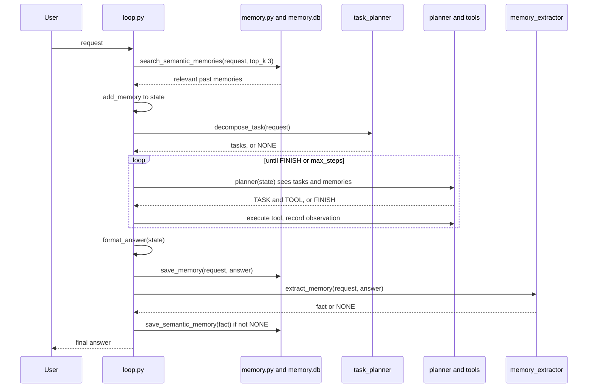

# Day 11: Long-Term Memory (Remember Across Runs)

**Theme:** give the agent a **persistent semantic memory** in SQLite. Before planning, it **recalls** relevant past memories. After answering, it **saves** the conversation and any durable fact about the user.

## 1. Pitch

> "On day 11 I gave the agent memory that survives restarts. Every conversation is stored in `memory.db` together with an embedding vector. When a new request arrives, I embed it, rank the stored memories by cosine similarity and inject the top matches into the state, so the planner and answer writer can use them. After the answer, a memory extractor LLM decides whether the exchange contains a lasting fact (a goal, skill or preference) and, if so, saves it as a separate memory."

## Architecture and Workflow

### Architecture

```
                                  ┌────────────── memory.py ───────────────┐
                                  │ create_database()   save_memory()      │
                                  │ search_semantic_memories()             │
                                  │ save_semantic_memory()                 │
                                  │ create_embedding()  cosine_similarity()│
                                  └──────────┬───────────────────▲─────────┘
                                             │ SQL               │ embeddings
                                             ▼                   │ (nomic-embed-text)
                                  ┌────────────────────┐   ┌──────────────┐
                                  │ memory.db (SQLite) │   │ embedding    │
                                  │ id, user_message,  │   │ model server │
                                  │ assistant_message, │   └──────────────┘
                                  │ embedding JSON,    │
                                  │ created_at         │
                                  └────────────────────┘
        ▲ RECALL (start)           ▲ SAVE (end)
        │                          │
┌───────┴──────────────────────────┴───────────── loop.py ─────────────────────────────┐
│ 1 recall memories ─► state["memories"]                                                │
│ 2 task_planner (returns NONE for greetings / facts / memory questions)                │
│ 3 planner + executor loop (as day 10), planner also sees memories                     │
│ 4 on FINISH: format_answer ─► save_memory ─► memory_extractor ─► save_semantic_memory │
└───────────────────────────────────────────────────────────────────────────────────────┘
       (planner.py, task_planner.py, answer.py, executor.py, state.py, MCP server as day 10)
```

### Two kinds of memory

| Type | Function | What is stored |
|---|---|---|
| **Episodic** | `save_memory(user, assistant)` | The whole exchange |
| **Semantic** | `save_semantic_memory(fact)` | One distilled fact, e.g. "Aziz is learning AI agent engineering" |

### Workflow



### How recall works (semantic search)

```
 query "What is my name?" ─► embedding vector
                                   │ cosine similarity with every stored vector
                                   ▼
   "my name is Aziz Alam"   0.82  ✔ kept      "I am learning MCP"   0.41  ✘ below threshold 0.50
                                   │ sort by score, keep top_k
                                   ▼
                       injected into state["memories"] ─► planner and answer prompts
```

Matching is by **meaning**, not keywords, so "What is my name?" finds "my name is Aziz".

### Build it yourself (7 steps)

1. Start from day 10.
2. Write `memory.py`: `create_database()` (one table with an `embedding TEXT` column), `create_embedding()`, `cosine_similarity()`.
3. Add `save_memory()`: embed `user + "\n" + assistant`, then `INSERT` with `json.dumps(embedding)`. Use `?` placeholders.
4. Add `search_semantic_memories()`: embed the query, `SELECT` all rows, `json.loads` each embedding, score, filter by `threshold`, sort descending, return `[:top_k]`.
5. Add `memories` and `add_memory()` to `state.py`, and show `state["memories"]` in the `planner` and `answer` prompts.
6. Teach `task_planner` to return `NONE` for greetings, personal facts, memory questions and general knowledge, and teach `planner` to return `FINISH` right away in those cases.
7. Write `memory_extractor.extract_memory()` (returns a fact or `NONE`). In `loop.py`, recall at the start and save at `FINISH`. Call `create_database()` once in `runner.py`.

```python
memories = search_semantic_memories(user_request, top_k=3)   # recall
for m in memories: add_memory(state, m)
...
save_memory(user_request, answer)                            # save
fact = extract_memory(user_request, answer)
if fact != "NONE": save_semantic_memory(fact)
```

## 2. Files

| File | Purpose |
|---|---|
| `memory.py` | SQLite storage, embeddings, similarity, save and search |
| `memory_extractor.py` | LLM that extracts one durable fact (or `NONE`) |
| `loop.py` | Agent loop with recall and save steps |
| `task_planner.py` | Decomposes the request, returns `NONE` when no tools are needed |
| `planner.py` | Chooses task and tool, aware of memories |
| `answer.py` | Final reply that can use memories |
| `state.py` | State plus `memories` and `add_memory()` |
| `runner.py` | Entry point, calls `create_database()` first |
| `executor.py`, `mcp_client.py`, `server.py` | Tool execution via MCP |
| `test_memory.py`, `test_memory_extractor.py`, `test_state.py`, `test_task_planner.py` | Manual tests |
| `memory.db` | Created at run time (SQLite file) |

## 3. Key concepts

| Concept | Meaning |
|---|---|
| **Short-term memory** | `state` for one request (day 9) |
| **Long-term memory** | Facts saved in a database and kept between runs |
| **Embedding** | A vector of numbers that captures the meaning of text |
| **Cosine similarity** | Angle-based closeness of two vectors, used to rank memories |
| **Threshold and top_k** | Filter weak matches, then limit how many memories are used |
| **Memory extraction** | Let an LLM decide what is worth keeping, to avoid storing noise |
| **Parameterised SQL** | `?` placeholders prevent SQL injection |

## 4. Run it

```bash
cd 11_Memory/agent
python3 test_memory.py              # saves 3 memories, searches "What is my name"
python3 test_memory_extractor.py    # shows the extracted fact
python3 runner.py                   # try: "my name is Aziz", restart, then "what is my name?"
```
Requires the embedding model: `ollama pull nomic-embed-text` (served at the `BASE_URL` in `.env`).

## 5. Interview Q&A

**Q: Why embeddings instead of keyword search?**
They match meaning ("name" vs "called"), so retrieval still works when the words differ.

**Q: Why store a fact separately from the conversation?**
Whole conversations are noisy. A distilled fact is short, specific and retrieves cleanly.

**Q: Why a threshold?**
Without it the top-k always returns something, even if it is irrelevant, and that can mislead the model.

**Q: How would this scale?**
It scans every row, so cost grows linearly. At scale use a vector database (FAISS, Chroma, pgvector) or an index.

## 6. Known issues (found while documenting)
- `memory.save_semantic_memory` uses `json.dump(embedding)`, which crashes. It should be `json.dumps`.
- `loop.py` passes the function `format_answer` into `extract_memory` instead of the answer text, and calls `format_answer(state)` twice (two LLM calls).
- `memory_extractor`'s prompt never says "otherwise reply NONE", but `loop.py` relies on it.
- `memory.db` is tracked by git and holds personal data. Consider adding it to `.gitignore`.

## 7. Cheat sheet
```
recall:  search_semantic_memories(request) -> state["memories"]
act:     task_planner -> planner -> executor (loop)
save:    save_memory(request, answer) + extract_memory -> save_semantic_memory(fact)
Memory = text + embedding in SQLite; recall = cosine similarity above a threshold.
```
