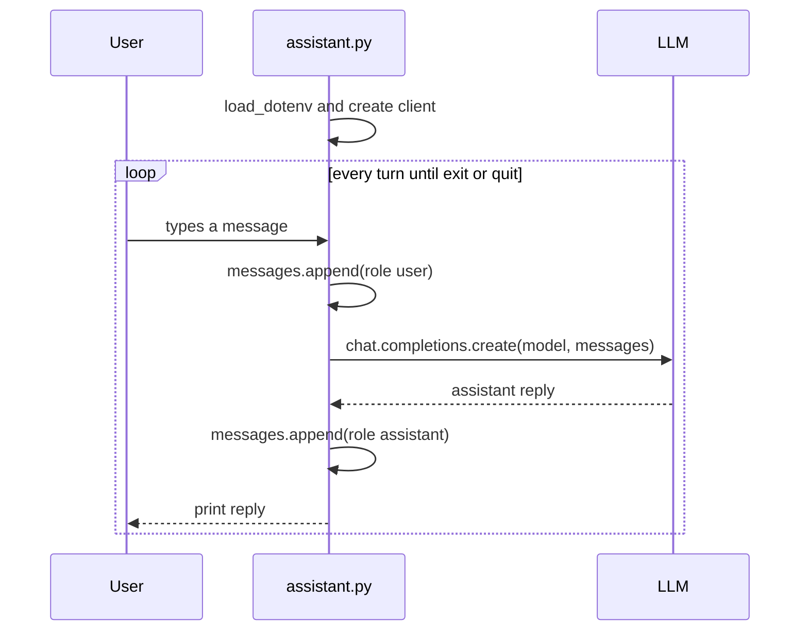

# Day 01: First LLM Call and a Chat Assistant

**Theme:** talk to an LLM from Python, then turn the one-shot call into a multi-turn chat that remembers the conversation.

## 1. Pitch

> "On day 1 I connected Python to an LLM through the OpenAI-compatible API, loading config from `.env`. I then built a terminal chat assistant that keeps the full message history, so the model remembers earlier turns."

## Architecture and Workflow

### Architecture

```
┌──────────────┐   text    ┌──────────────────────────────┐   HTTPS    ┌─────────────────────┐
│     USER     │ ────────► │  assistant.py (Python app)   │ ─────────► │  LLM server         │
│  (terminal)  │ ◄──────── │                              │ ◄───────── │  (Ollama / OpenAI)  │
└──────────────┘   reply   │  messages = [ ... history ]  │  messages  │  /chat/completions  │
                           └──────────────┬───────────────┘   + reply  └─────────────────────┘
                                          │ reads once at start
                                          ▼
                                   .env  (BASE_URL, API_KEY, MODEL)
```

The only moving part is a Python **list** (`messages`). The model is stateless, so the app owns the memory.

### Workflow



### Build it yourself (5 steps)

1. `pip install openai python-dotenv`, then create `.env` with `BASE_URL`, `API_KEY`, `MODEL`.
2. `load_dotenv()` and create `client = OpenAI(api_key=..., base_url=...)`.
3. Make one call with `messages=[{"role": "user", "content": "hi"}]` and print `response.choices[0].message.content` (this is `hello_ai.py`).
4. Wrap it in `while True`, keeping a `messages` list.
5. After each reply, append it as `{"role": "assistant", ...}` so the next call includes it.

```python
messages = []
while True:
    messages.append({"role": "user", "content": input("You: ")})
    reply = client.chat.completions.create(model=MODEL, messages=messages)
    text = reply.choices[0].message.content
    messages.append({"role": "assistant", "content": text})
    print(text)
```

## 2. Files

| File | Purpose |
|---|---|
| `hello_ai.py` | The smallest possible LLM call: one question in, one answer printed |
| `assistant.py` | Interactive chatbot with conversation memory |
| `.env` | `BASE_URL`, `API_KEY`, `MODEL` (kept out of the code) |

## 3. How it works

### `hello_ai.py`
1. `load_dotenv()` reads `.env` into environment variables.
2. `OpenAI(api_key=..., base_url=...)` creates the client. A custom `base_url` lets the **same library talk to any OpenAI-compatible server** (here, a local Ollama).
3. `client.chat.completions.create(model, messages)` sends the request.
4. `response.choices[0].message.content` is the model's text.

### `assistant.py`
```
messages = []                      # memory
loop:
    read user input
    exit/quit? -> stop
    messages.append({"role": "user", ...})
    response = LLM(messages)       # send the WHOLE history
    messages.append({"role": "assistant", ...})
    print reply
```

## 4. Key concepts

| Concept | Meaning |
|---|---|
| **Chat Completions API** | Send a list of messages, get the next assistant message |
| **Roles** | `system` (rules), `user` (human), `assistant` (model) |
| **Stateless model** | The model remembers nothing. *You* resend history every call, and that is what "memory" means |
| **`.env` + `python-dotenv`** | Keeps secrets and settings out of source code |
| **OpenAI-compatible endpoint** | Swap providers (Ollama, OpenAI, etc.) by changing `BASE_URL` and `MODEL` only |
| **Context window** | History grows each turn, so cost and latency grow, and eventually it overflows |

## 5. Run it

```bash
cd 1_first_llm_chat
python3 hello_ai.py
python3 assistant.py        # type "exit" or "quit" to stop
```

## 6. Interview Q&A

**Q: Does an LLM remember previous messages?**
No. It is stateless. The app stores messages in a list and resends them each call.

**Q: Why use `base_url`?**
To point the OpenAI SDK at a different, compatible server such as local Ollama, with no code change.

**Q: What happens if the conversation gets very long?**
It eventually exceeds the context window and cost grows. Fix: truncate old messages, summarise them, or use retrieval.

**Q: Why keep the API key in `.env`?**
To avoid hard-coding secrets and committing them to git.

## 7. Limitations and next steps
- No system prompt, so the model has no persona (day 2 fixes this).
- History grows without bound.
- No error handling for network or API failures.
- **Security note:** `.env` is tracked by git in this repo and there is no `.gitignore`. Add a `.gitignore` with `.env` and rotate any real keys.

## 8. Cheat sheet
```
.env -> load_dotenv -> OpenAI(client) -> chat.completions.create(messages) -> choices[0].message.content
Memory = a Python list you resend every time.
```
