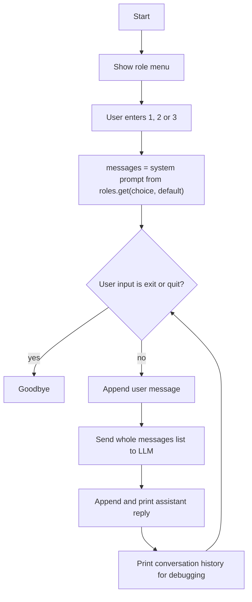

# Day 02: System Prompts and Role-Based Personas

**Theme:** control *how* the model behaves by choosing a **system prompt** (a persona) at startup.

## 1. Pitch

> "On day 2 I added role selection. The user picks a persona (teacher, Python expert, travel guide) and that choice becomes the `system` message at the start of the history, which steers every later reply."

## Architecture and Workflow

### Architecture

```
                 start-up menu: 1 Teacher | 2 Python Expert | 3 Travel Guide
                                        │ user picks a number
                                        ▼
                         roles = { "1": prompt, "2": prompt, "3": prompt }
                                        │ roles.get(choice, default)
                                        ▼
┌────────┐        ┌───────────────────────────────────────────────┐        ┌──────────┐
│  USER  │ ─────► │ messages = [ {system: persona},               │ ─────► │   LLM    │
│        │ ◄───── │              {user}, {assistant}, {user} ... ]│ ◄───── │          │
└────────┘        └───────────────────────────────────────────────┘        └──────────┘
```

Same chat loop as day 1. The only new piece is the first message, with role `system`, which sets the persona.

### Workflow



### Build it yourself (4 steps)

1. Start from the day 1 chat loop.
2. Create a `roles` dict that maps menu choices to system prompts.
3. Initialise `messages` with a single `{"role": "system", "content": roles.get(choice, fallback)}`.
4. Everything else is unchanged. Use `.get()` with a fallback so a bad menu choice still works.

```python
messages = [{"role": "system", "content": roles.get(choice, "You are a helpful assistant.")}]
```

## 2. Files

| File | Purpose |
|---|---|
| `assistant.py` | Chat assistant with a menu of roles and a visible conversation history |
| `.env` | `BASE_URL`, `API_KEY`, `MODEL` |

## 3. How it works

1. A `roles` dictionary maps `"1"`, `"2"`, `"3"` to system-prompt strings:
   - 1 → friendly school teacher (explain like to a 12-year-old)
   - 2 → Python expert (simple explanations)
   - 3 → travel guide (food, tips, transport)
2. The user types a number. `roles.get(choice, default)` picks the prompt, with a **safe default** if the input is invalid.
3. `messages` starts with `[{"role": "system", "content": <chosen prompt>}]`.
4. The same chat loop as day 1 runs. After each reply, it **prints the entire conversation history**, which is useful for seeing exactly what the model receives.

```
[system: persona] -> [user] -> [assistant] -> [user] -> [assistant] ...
        ^ always first, shapes every answer
```

## 4. Key concepts

| Concept | Meaning |
|---|---|
| **System prompt** | Hidden instructions that set persona, tone and rules |
| **Prompt engineering** | Wording prompts to get the behaviour you want |
| **Dict lookup with default** | `dict.get(key, default)` avoids a crash on bad input |
| **Why print history?** | Shows that the "memory" is just a list of dicts |

## 5. Run it

```bash
cd 2_role_based_assistant
python3 assistant.py     # choose 1, 2 or 3, then chat; "exit" to quit
```

## 6. Interview Q&A

**Q: What is a system prompt and why is it useful?**
It is an instruction message the model treats as high-priority context. It sets role, style and constraints without the user repeating them.

**Q: Is a system prompt a security boundary?**
No. Users can sometimes override it with prompt injection. Never put secrets in it or rely on it alone for safety.

**Q: Same question, different roles. What changes?**
Only the first message in the list. The model, user message and API call are identical.

**Q: Where would you store the personas in a real app?**
In a config file or database, so they can be edited without code changes.

## 7. Limitations and next steps
- Typos in the role strings (e.g. "schjool") are cosmetic but would be visible to the model.
- The persona is fixed at startup, so there is no switching mid-chat.
- Printing the full history on every turn gets noisy.
- No tools yet, so the model can only talk (day 4 adds tools).
- Day 3 has no folder in this repo.

## 8. Cheat sheet
```
roles dict -> input() -> roles.get() -> messages[0] = system prompt -> normal chat loop
```
