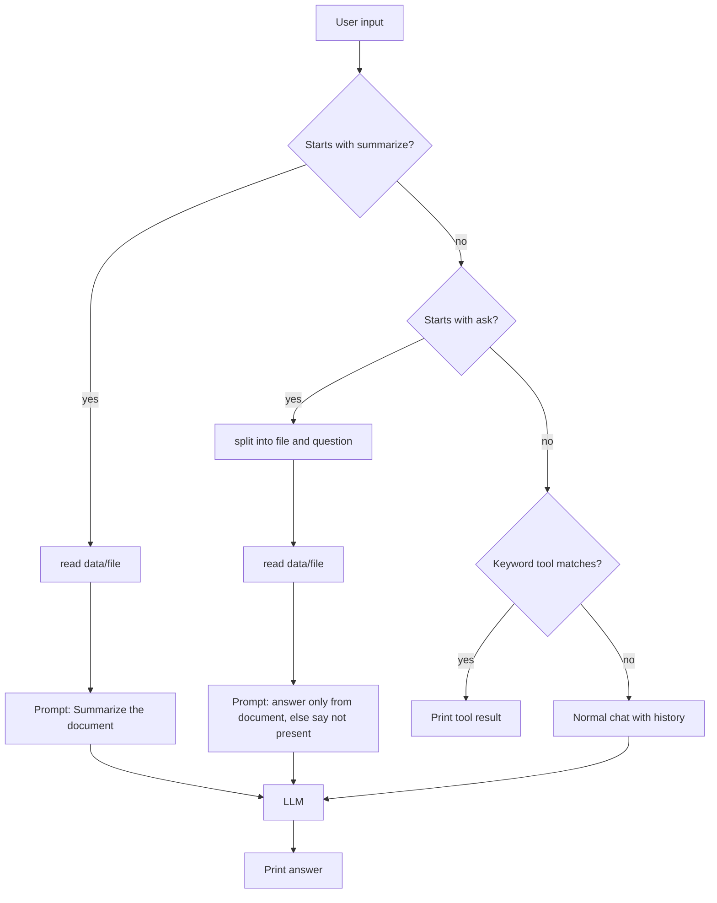

# Day 05: Working with Files (Summarize and Ask Questions About a Document)

**Theme:** give the assistant a **file-reading tool** and use it for two document tasks: summarising and question answering (grounded in the file text).

## 1. Pitch

> "On day 5 I added a `read_text_file` tool. With the commands `summarize <file>` and `ask <file> <question>`, the assistant loads a document from `data/`, puts its text into the prompt, and asks the LLM to summarise it or answer strictly from it. This is manual context injection, the idea that RAG automates on day 6."

## Architecture and Workflow

### Architecture

```
                        ┌───────────────────── assistant.py ─────────────────────┐
 user command ────────► │  command router (checks the start of the text)          │
                        │   "summarize <file>"   "ask <file> <question>"   other  │
                        └───────┬─────────────────────┬──────────────────────┬────┘
                                │                     │                      │
                                ▼                     ▼                      ▼
                        read_text_file()      read_text_file()        execute_tool()
                        data/<file>           data/<file>             or normal chat
                                │                     │
                                ▼                     ▼
                      prompt: "Summarize"     prompt: "Answer ONLY from the document"
                                └──────────┬──────────┘
                                           ▼
                                          LLM ──► printed answer
```

The whole file goes **inside the prompt**. This is the idea RAG (day 6) improves on by sending only the relevant document.

### Workflow



### Build it yourself (4 steps)

1. Add `read_text_file(path)` to `tools.py`. Return error text instead of raising, so the chat keeps running.
2. For `summarize`, strip the command word, read the file and build `f"Summarize the following document:\n\n{content}"`.
3. For `ask`, use `user_input.split(maxsplit=2)` to get `[command, filename, question]`.
4. Write a grounded prompt that says "answer only from the document, otherwise say it is not present". This is what reduces hallucination.

## 2. Files

| File | Purpose |
|---|---|
| `tools.py` | Day 4 tools plus the new `read_text_file(file_path)` |
| `tool_manager.py` | Keyword router (time / dice / password), unchanged from day 4 |
| `assistant.py` | Chat app, now with `summarize` and `ask` commands |
| `data/notes.txt` | Sample doc about Python |
| `data/project.txt` | Sample doc about a "Smart Library System" project |
| `test_tool.py`, `test_tool_manager.py`, `test_tool_file.py` | Test scripts for tools, routing and the file reader |

## 3. New tool: `read_text_file`

```python
with open(file_path, 'r') as f: return f.read()
```
It returns friendly error strings instead of crashing on `FileNotFoundError` or other exceptions.

## 4. Command flow

```
summarize notes.txt
   -> read data/notes.txt
   -> prompt: "Summarize the following document: <text>"
   -> LLM -> print

ask project.txt Who is on the team?
   -> split into [ "ask", "project.txt", "Who is on the team?" ]   (split(maxsplit=2))
   -> read data/project.txt
   -> prompt: "Answer ONLY from the document; else say the answer is not present"
   -> LLM -> print
```

## 5. Key concepts

| Concept | Meaning |
|---|---|
| **Context injection** | Paste the relevant text into the prompt so the model can use it |
| **Grounded answering** | Instruct the model to answer only from the supplied text and to admit when it isn't there, which reduces hallucination |
| **`str.split(maxsplit=2)`** | Splits on the first two spaces only, so the question keeps its spaces |
| **Command parsing** | Using `startswith("summarize ")` and `startswith("ask ")` as simple commands |
| **Graceful errors** | Return an error message instead of letting the program crash |

## 6. Run it

```bash
cd 5_file_summarizer_qa                      # run from here, because the code reads "data/<file>"
python3 test_tool_file.py
python3 assistant.py
#   summarize notes.txt
#   ask project.txt What database does the project use?
```

## 7. Interview Q&A

**Q: Why tell the model to answer only from the document?**
It limits hallucination and makes answers verifiable against the source.

**Q: What breaks when the file is huge?**
It won't fit in the context window and costs more. Solutions: chunking and retrieval (day 6).

**Q: Why return error strings from the tool?**
So the app keeps running and the user sees what went wrong.

**Q: Why `maxsplit=2`?**
To separate the command and filename from the free-text question.

## 8. Known issues
- Same unindented `break` bug as day 4's `assistant.py`: normal chat messages end the loop without reaching the LLM.
- `ask file` with no question raises `IndexError`, because there is no validation of `parts`.
- The file path is hard-coded relative to `data/`, so the script must be run from `5_file_summarizer_qa/`.
- No path sanitising, so `summarize ../../secret.txt` could read outside `data/` (path traversal).
- Whole files are sent every time, with no chunking.

## 9. Cheat sheet
```
read_text_file -> put text in prompt -> "answer only from this" -> LLM
Two commands: summarize <file>, ask <file> <question>
```
