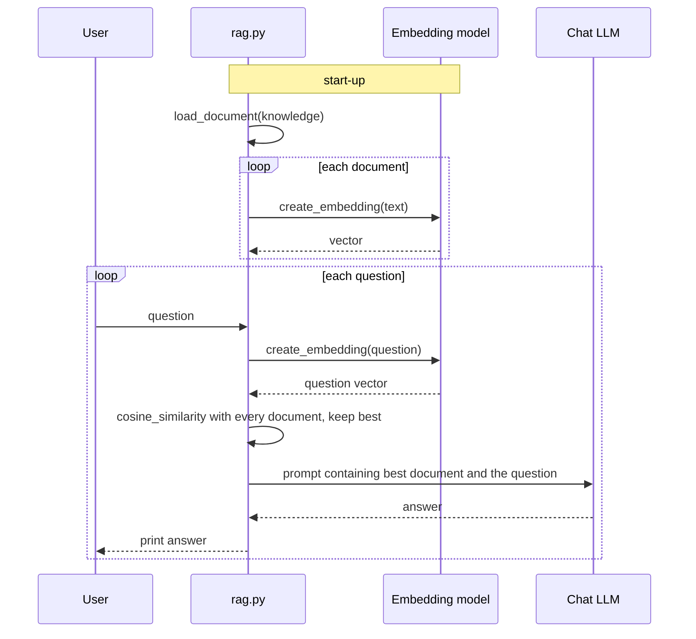

# Day 06: RAG (Retrieval-Augmented Generation) with Embeddings

**Theme:** instead of the user naming a file, the system **finds the most relevant document automatically** using embeddings and cosine similarity, then answers from it.

## 1. Pitch

> "On day 6 I built a basic RAG pipeline. Each document in `knowledge/` is converted to an embedding vector with `nomic-embed-text` (via Ollama). At question time I embed the question, compute cosine similarity against every document, pick the best match, and put that document into the prompt so the LLM answers using only that context."

## Architecture and Workflow

### Architecture

```
┌─────────────────────────── INDEXING (once at start-up) ───────────────────────────┐
│ knowledge/*.txt ─► load_document() ─► {filename: text} ─► create_embedding() ─┐     │
│                                                                                ▼    │
│                                                        document_embeddings {filename: vector}
└─────────────────────────────────────────────────────────────────────────────────────┘

┌─────────────────────────── QUERYING (every question) ─────────────────────────────┐
│ question ─► create_embedding() ─► cosine_similarity vs every document vector         │
│                                              │ pick highest score                    │
│                                              ▼                                       │
│                                    best document text                                │
│                                              │                                       │
│              prompt = "Answer only using: <document>  Question: <q>"                 │
│                                              ▼                                       │
│                                       Chat LLM (.env) ─► answer                      │
└─────────────────────────────────────────────────────────────────────────────────────┘

 Two models:  embedding model = nomic-embed-text on local Ollama (text -> numbers)
              chat model      = whatever .env points to (numbers are never shown to it)
```

### Workflow



### Build it yourself (5 steps)

1. Run Ollama and `ollama pull nomic-embed-text`. Point an `OpenAI(base_url="http://localhost:11434/v1", api_key="ollama")` client at it.
2. Write `create_embedding(text)` that returns `client.embeddings.create(model=..., input=[text]).data[0].embedding`.
3. Write `cosine_similarity(a, b)` with NumPy: `dot(a, b) / (norm(a) * norm(b))`.
4. At start-up embed every document once and keep a dict `{filename: vector}`.
5. For each question: embed it, loop over the dict, keep the highest score, then paste that document into the prompt.

```python
best = max(doc_vectors, key=lambda name: cosine_similarity(q_vec, doc_vectors[name]))
prompt = f"Answer using only this content: {documents[best]}\nQuestion: {question}"
```

## 2. Files

| File | Purpose |
|---|---|
| `rag.py` | **Main app** for this day: the full RAG chat loop |
| `retriever.py` | `load_document()` reads all `knowledge/*.txt` into a dict. `retrieve(question)` is a naive substring-search baseline |
| `similarity.py` | `cosine_similarity(vec1, vec2)` using NumPy |
| `test_embedding.py` | Defines `create_embedding(text)` and also runs a demo comparing two sentences |
| `test_retriever.py` | Tries the baseline `retrieve("weather")` |
| `knowledge/*.txt` | The knowledge base: `machinelearning`, `mysql`, `python`, `weather` |

## 3. The RAG pipeline

```
 INDEXING (once at startup)                 QUERYING (every question)
 ───────────────────────────                ─────────────────────────────
 knowledge/*.txt                            user question
      │ load_document()                          │ create_embedding()
      ▼                                          ▼
 {filename: text}                           question vector
      │ create_embedding()                       │
      ▼                                          ▼ cosine_similarity vs each doc
 {filename: vector}  ───────────────────►   best-scoring document
                                                 │
                                                 ▼
                              prompt = "Answer using only this content: <doc> Question: <q>"
                                                 │
                                                 ▼
                                                LLM -> answer
```

## 4. Key ideas explained simply

- **Embedding:** a list of numbers (768 for `nomic-embed-text`) that captures a text's *meaning*. Similar meaning leads to vectors pointing in similar directions.
- **Cosine similarity:** `dot(a, b) / (|a| * |b|)`. It ranges from -1 to 1, and closer to 1 means more similar. It compares direction, not length. The code returns 0 if either vector has zero length, to avoid dividing by zero.
- **Retrieval:** pick the document with the highest score. This is **top-1** retrieval.
- **Augmentation:** insert the retrieved text into the prompt.
- **Generation:** the LLM writes the answer from that context.
- **Why RAG?** It gives the LLM private or fresh knowledge without retraining, and reduces hallucination.
- **Two models:** a chat model (`MODEL` in `.env`) for answers and an embedding model (`nomic-embed-text`) for vectors.

## 5. Function reference

| Function | Role |
|---|---|
| `load_document(path)` | Reads every `.txt` in `knowledge/` and returns `{filename: content}` |
| `retrieve(question)` | Baseline keyword search (the question must be a substring of a document) |
| `create_embedding(content)` | Calls `client.embeddings.create(model="nomic-embed-text")` on a local Ollama and returns one vector |
| `cosine_similarity(v1, v2)` | The similarity score |

## 6. Run it

```bash
ollama pull nomic-embed-text       # one time
cd 6_rag_embeddings                           # code reads the "knowledge" folder relative to cwd
python3 test_embedding.py          # sanity check: similarity of two sentences
python3 test_retriever.py          # naive baseline
python3 rag.py                     # full RAG chat (try: "What is MySQL?")
```

## 7. Interview Q&A

**Q: What is RAG and why use it?**
Retrieve relevant text, add it to the prompt, then generate. It adds knowledge without fine-tuning and reduces hallucination.

**Q: Why embeddings instead of keyword search?**
They match meaning, so "forecast" can match "weather" even with no shared words. `retrieve()` shows the limit of keywords: it only finds exact substrings.

**Q: Why cosine similarity?**
It measures the angle between vectors, so document length doesn't dominate.

**Q: What would you change for production?**
Chunk documents, store vectors in a vector DB (FAISS, Chroma, pgvector), return top-k, cache the embeddings, and show source citations.

**Q: What are the risks of top-1 retrieval?**
If the best document is wrong or the answer spans several, the answer will be wrong. Top-k plus a minimum score threshold helps.

## 8. Known issues and limitations
- Whole files are embedded (no chunking). This is fine for tiny files but poor for long ones.
- Embeddings are recomputed every startup, and there is no persistence.
- `load_document(file_path)` ignores its argument and always reads `"knowledge"`.
- `test_embedding.py` runs demo code on import, and `rag.py` imports `create_embedding` from it, so a demo runs on every start. A separate `embeddings.py` would be cleaner.
- The embedding client's URL and model are hard-coded to local Ollama, while the chat client uses `.env`.
- There is always a best document, even if its similarity is low. A threshold would allow "I don't know".
- `messages` stores the full retrieved text for each turn, so the history grows quickly.

## 9. Cheat sheet
```
Index:  text -> embedding -> store
Query:  question -> embedding -> cosine vs all -> best doc -> prompt -> LLM
```
