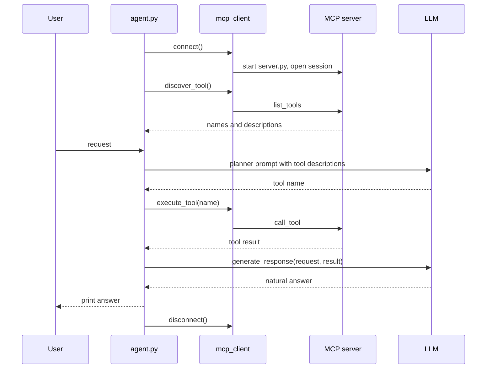

# Day 08: MCP (Model Context Protocol): Tools as a Separate Server

**Theme:** move the tools out of the app into an **MCP server**. The agent now *discovers* tools at runtime and calls them over the protocol.

## 1. Pitch

> "On day 8 I introduced MCP. The tools live in `server.py` (built with FastMCP). The agent connects with an MCP client, **discovers** the available tools, shows their names and descriptions to an LLM planner, runs the chosen tool remotely, and finally asks the LLM to phrase a natural answer. Tools are decoupled from the agent, so I can add or change them without touching the agent code."

## Architecture and Workflow

### Architecture

```
┌──────────────────────── AGENT PROCESS ────────────────────────┐        ┌───────── MCP SERVER ─────────┐
│                                                               │        │  server.py (FastMCP)         │
│  agent.py                                                     │        │  @mcp.tool current_time     │
│   ├─ planner()  ──► LLM  "which tool?"                        │        │  @mcp.tool roll_dice        │
│   └─ generate_response() ──► LLM  "say it nicely"             │        │  @mcp.tool generate_password│
│                                                               │        └──────────────▲──────────────┘
│  mcp_client.py   connect / discover_tool / execute_tool /     │   MCP protocol        │
│                  disconnect  ─────────────────────────────────┼───────(stdio)─────────┘
└───────────────────────────────────────────────────────────────┘   list_tools, call_tool
```

The agent no longer imports tool functions. It **discovers** them at run time from the server, so tools can change without touching the agent.

### Workflow



### Build it yourself (5 steps)

1. `pip install fastmcp`. In `server.py` create `mcp = FastMCP("Time Server")` and decorate functions with `@mcp.tool()`. **The docstring is the tool description the LLM reads.**
2. Finish the file with `if __name__ == "__main__": mcp.run()`.
3. Write `mcp_client.py` with four async helpers: `connect` (`Client("server.py")` plus `__aenter__`), `discover_tool` (`list_tools`), `execute_tool` (`call_tool`), `disconnect` (`__aexit__`).
4. Check it with `test_client.py` before adding any LLM.
5. In `agent.py`: build a tool-description string, ask the LLM for a tool name, call `execute_tool`, then ask the LLM to phrase the result.

## 2. Files

| File | Purpose |
|---|---|
| `server.py` | FastMCP server "Time Server" exposing 3 tools |
| `mcp_client.py` | Thin async wrapper: `connect`, `disconnect`, `discover_tool`, `execute_tool` |
| `agent.py` | **Main app**: connect, discover, plan, execute, respond, disconnect |
| `test_client.py` | Checks the MCP plumbing without any LLM |

## 3. The MCP server (`server.py`)

```python
mcp = FastMCP("Time Server")

@mcp.tool()
def current_time(): ...
```

| Tool | Returns |
|---|---|
| `current_time` | `YYYY-MM-DD HH:MM:SS` |
| `roll_dice` | Random 1–6 |
| `generate_password` | Random 12-char password (`secrets`) |

The **function name becomes the tool name** and the **docstring becomes the description** the LLM reads. `mcp.run()` serves over **stdio**.

## 4. The MCP client (`mcp_client.py`)

| Function | What it does |
|---|---|
| `connect()` | `Client("server.py")` plus `__aenter__()`. FastMCP launches the server as a subprocess |
| `disconnect(client)` | `__aexit__()` closes it |
| `discover_tool(client)` | `await client.list_tools()` returns the tool objects (name, description, schema) |
| `execute_tool(client, name, args=None)` | `await client.call_tool(name, args or {})` |

All are `async`, because the client talks to another process.

## 5. Agent flow (`agent.py`)

```
1. connect()                      -> MCP client
2. discover_tool()                -> [current_time, roll_dice, generate_password]
3. input("You: ")
4. planner(request, tools)        -> LLM sees tool names+descriptions, replies with ONE tool name
5. execute_tool(client, name)     -> result object
6. generate_response(request, result) -> LLM turns raw output into a natural answer
7. disconnect()
```
This is a **single-shot** agent: one request, one tool, one answer. There is no loop yet (day 9).

## 6. Key concepts

| Concept | Meaning |
|---|---|
| **MCP** | An open protocol that standardises how LLM apps discover and call tools and data sources |
| **Server / client** | Server hosts tools. Client (inside the agent) lists and calls them |
| **Tool discovery** | The agent learns tools at runtime, so there is no hard-coded list in the planner prompt |
| **stdio transport** | Client and server talk through the subprocess's stdin and stdout |
| **FastMCP** | A Python library that makes MCP servers and clients a few lines of code |
| **async/await** | Needed because calls to the server are I/O-bound. Run with `asyncio.run(main())` |

## 7. Run it

```bash
cd 8_mcp_tools                   # Client("server.py") is a relative path, so run from here
python3 test_client.py     # no LLM needed: lists tools and calls current_time
python3 agent.py           # try: "roll a dice" or "what is the time?"
```

## 8. Interview Q&A

**Q: What problem does MCP solve?**
Without it, every app hard-codes its own tools and glue code. With MCP, any compliant client can use any compliant server, like USB for AI tools.

**Q: Why does the tool docstring matter?**
It is the description the planner LLM sees. A vague docstring leads to wrong tool choices.

**Q: What does `list_tools()` return?**
Tool objects with `name`, `description` and an input schema.

**Q: Why `async`?**
Tool calls cross a process boundary and take time. Async lets the program wait without blocking.

**Q: How is this better than day 7's local `tools.py`?**
Tools are discovered dynamically and can be reused by other apps or languages. The agent code doesn't change when tools are added.

## 9. Known issues
- `execute_tool` passes no arguments, so tools needing parameters aren't supported yet.
- The planner reply isn't validated against the tool list. Extra words from the LLM would cause a "tool not found" error.
- In `agent.py`, `main()` has a local `client` (MCP) that shadows the module-level `client` (OpenAI). It works, but naming them `llm` and `mcp` would be clearer.
- The `roll_dice` docstring mentions "given number of sides" but the function takes no parameter.
- Single tool call only. Multi-step requests ("password AND time") aren't handled.

## 10. Cheat sheet
```
server.py  = tools (FastMCP)          mcp_client.py = connect / list / call / disconnect
agent.py   = discover -> plan -> call -> explain
```
