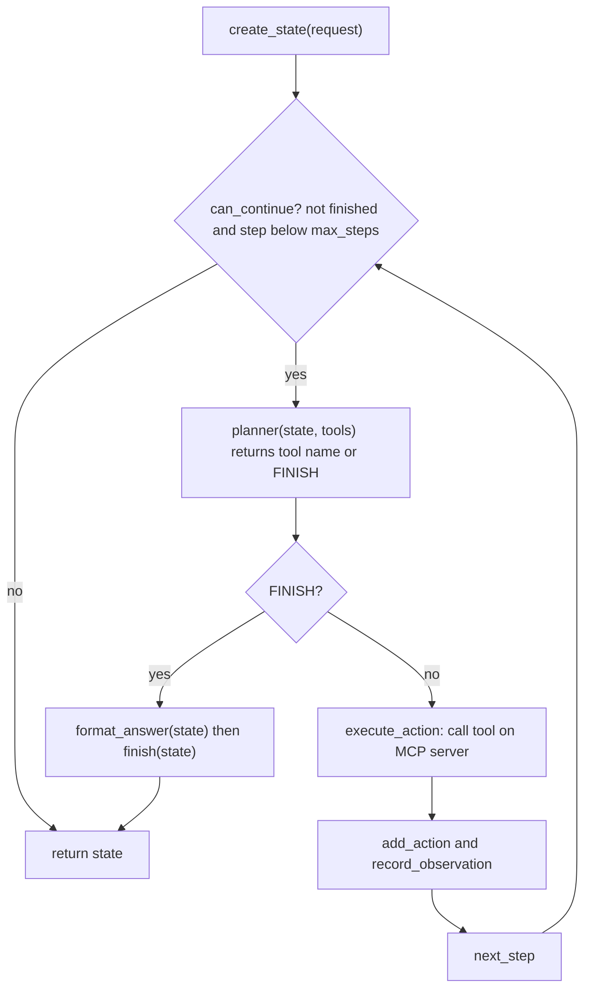

# Day 09: The Agent Loop (Plan, Act, Observe, Repeat) with State

**Theme:** upgrade the single-shot agent to a **loop** that can do **multi-step** requests, remembering what it has done in a **state** object.

## 1. Pitch

> "On day 9 I built a real agent loop. Instead of one tool call, the agent repeats: the planner looks at the state (request, actions so far, observations) and picks the next tool, or says `FINISH`. The executor runs the tool on the MCP server, and the result is saved into the state. A `max_steps` limit prevents infinite loops. When the planner says `FINISH`, an LLM writes the final answer from the collected observations."

## Architecture and Workflow

### Architecture

```
┌────────────────────────────── AGENT PROCESS ──────────────────────────────┐      ┌──── MCP SERVER ────┐
│                                                                            │      │ server.py          │
│  runner.py  (entry: connect, discover, input, run loop, print)             │      │ current_time       │
│      │                                                                     │      │ roll_dice          │
│      ▼                                                                     │      │ generate_password  │
│  loop.py  run_agent_loop()  ◄── the HEART                                  │      └─────────▲──────────┘
│      │ reads / writes                                                      │                │
│      ▼                                                                     │                │
│  state.py  { request, actions[], observations[], step, finished, answer }  │                │
│      ▲            ▲                    ▲                                   │                │
│      │            │                    │                                   │                │
│  planner.py   executor.py ─► mcp_client.py ─────────────────────────────────┼────────────────┘
│  (LLM picks   (runs the tool)                                              │
│   next tool                                                                │
│   or FINISH)          format_answer() ─► LLM writes the final reply        │
└────────────────────────────────────────────────────────────────────────────┘
```

Planner and executor are **passed into** the loop (dependency injection), so the loop never knows how they work.

### Workflow



### Example trace: "generate a password and tell me the time"

| Step | Planner returns | Observation stored |
|---|---|---|
| 1 | `generate_password` | `aB3$...` |
| 2 | `current_time` | `2026-11-28 10:15:00` |
| 3 | `FINISH` | `format_answer` writes the reply |

### Build it yourself (6 steps)

1. Copy `server.py` and `mcp_client.py` from day 8.
2. Write `state.py` first: a dict plus `create_state`, `add_action`, `record_observation`, `next_step`, `can_continue`, `finish`. Test it with `test_state.py` (no LLM needed).
3. Write `executor.py`: call `execute_tool`, return `result.content[0].text`.
4. Write `planner.py`: put request, actions, observations and tool descriptions in the prompt, and require "tool name or FINISH".
5. Write `loop.py` as `while can_continue(state):` plan, act, record, step.
6. Write `runner.py` to connect, discover, call `run_agent_loop` and print `state["final_answer"]`.

```python
while can_continue(state):
    action = planner(state, tools)
    if action == "FINISH":
        finish(state, format_answer(state)); break
    obs = await execute_action(action, state, client)
    add_action(state, action); record_observation(state, action, obs); next_step(state)
```

## 2. Layout

```
9_agent_loop_state/agent/
│   ├── runner.py          entry point
│   ├── loop.py            run_agent_loop(): the heart
│   ├── planner.py         planner(): decides next action or FINISH
│   ├── executor.py        execute_action(): runs a tool via MCP
│   ├── mcp_client.py      connect / disconnect / discover / execute (same as day 8)
│   ├── server.py          FastMCP tools (same as day 8)
│   ├── state.py           the agent's memory + helpers
│   ├── test_state.py      exercises state.py without an LLM
│   └── .env
```

## 3. Flow

```
runner.main()
  ├─ connect() -> mcp
  ├─ discover_tool(mcp) -> tools
  ├─ input("User:")
  └─ run_agent_loop(request, planner, execute_action, format_answer, tools, mcp)
        state = create_state(request)
        while can_continue(state):             # not finished AND step < max_steps
            action = planner(state, tools)     # LLM: next tool name or FINISH
            if action == "FINISH":
                finish(state, format_answer(state)); break
            observation = await execute_action(action, state, mcp)
            add_action(state, action)
            record_observation(state, action, observation)
            next_step(state)
        return state
  print(state["final_answer"]); disconnect(mcp)
```

**Example:** "generate a password and tell me the time"
- Step 1: planner returns `generate_password`, observation `aB3$...`
- Step 2: planner returns `current_time`, observation `2026-...`
- Step 3: planner returns `FINISH`, so `format_answer` writes the reply

## 4. `state.py` reference

State dict: `user_request, current_step, max_steps (default 5), actions[], observations[], finished, final_answer`.

| Function | Purpose |
|---|---|
| `create_state(request, max_steps=5)` | Build a fresh state |
| `add_action(state, action)` | Log which tool was called |
| `record_observation(state, action, observation)` | Save step number, tool and result |
| `next_step(state)` | Increment the step counter |
| `can_continue(state)` | `True` while unfinished and under the step limit |
| `finish(state, answer)` | Store the final answer and mark finished |

## 5. Other modules

- **`planner.py`:** `build_tool_descriptions(tools)` formats the tool list. `planner(state, tools)` builds a prompt with the request, completed actions, observations and tools. The rules say: choose only one action, never repeat, use observations, return `FINISH` when done, and return only the tool name.
- **`executor.py`:** calls `execute_tool` and unwraps the MCP result to plain text (`result.content[0].text`).
- **`loop.py`:** takes `planner`, `execute_action` and `format_answer` as **parameters** (dependency injection), so they can be swapped or mocked.
- **`runner.py`:** wires everything together and defines `format_answer(state)`, an LLM call that writes the final reply and must not mention tools or planning.

## 6. Key concepts

| Concept | Meaning |
|---|---|
| **Agent loop / ReAct** | Reason, act, observe, repeat until done |
| **State / memory** | The single source of truth passed to every component |
| **Observation** | The result a tool returns, fed back to the planner |
| **Stop conditions** | `FINISH` from the planner, or `max_steps` reached |
| **Dependency injection** | Passing functions in rather than hard-coding them |

## 7. Run it

```bash
cd 9_agent_loop_state/agent
python3 test_state.py     # no LLM or server needed
python3 runner.py         # try: "generate a password and tell me the current time"
```

## 8. Interview Q&A

**Q: How does an agent differ from day 8's single-shot flow?**
It loops: after each tool result it re-plans, so it can chain several tools and decide when it is finished.

**Q: How do you stop infinite loops?**
`max_steps` in `can_continue()`, plus an explicit `FINISH` signal.

**Q: How does the planner avoid repeating a tool?**
The prompt includes the completed actions and observations, and a rule says "never repeat an action". This relies on the LLM obeying, so a stricter design would enforce it in code.

**Q: Why pass `planner` and `execute_action` into the loop?**
To make the loop independent of implementations. It is easy to test with fakes and to swap components.

**Q: Why a state dict?**
It is simple, transparent and serialisable (loggable and resumable).

## 9. Known issues (and how day 10 improves them)
- `planner.py` sends `"role": "User"` (capital U). The valid role is lowercase `user`, and some servers reject it. Day 10 fixed this.
- The planner has no explicit task list, so it must infer what is left from observations. **Day 10 adds task decomposition.**
- `state.py` has no tasks or results, and `loop.py` has no parsing for a richer decision format.
- The planner reply is not validated, so a typo'd tool name goes to MCP and errors.
- Tools take no arguments, which is the same limitation as day 8.

## 10. Cheat sheet
```
state = create_state
while can_continue: planner -> (FINISH? answer) -> execute -> add_action -> record_observation -> next_step
Day 8 = one shot.  Day 9 = loop + memory.  Day 10 = loop + memory + task plan.
```
