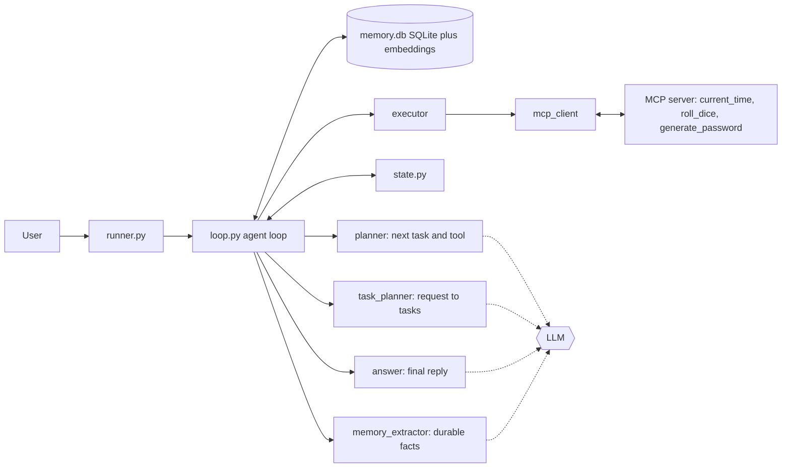

# AI Agent Development: Learning Path

A day-by-day project that builds an AI agent from a first LLM call up to an agent with tools, planning and long-term memory. Each folder has its own README with an architecture diagram, a workflow diagram and build-it-yourself steps.

## How the days build on each other

```
 Day 1   LLM call + chat history            messages list = memory
   │
 Day 2   + system prompt (roles)            persona
   │
 Day 4   + tools (keyword router)           Python functions as "hands"
   │
 Day 5   + file summarize / ask             document inside the prompt
   │
 Day 6   + RAG with embeddings              retrieve the right document by meaning
   │
 Day 7   + LLM chooses the tool             plan with the LLM, act in code
   │
 Day 8   + MCP server                       tools live outside the agent, discovered at run time
   │
 Day 9   + agent loop and state             plan, act, observe, repeat
   │
 Day 10  + task decomposition               what to do, then how
   │
 Day 11  + long-term memory                 recall and save across runs (SQLite + embeddings)
```

## Final architecture (day 11)



## Folders

| Day | Folder | Concept |
|---|---|---|
| 1 | `1_first_llm_chat` | LLM API call, conversation history |
| 2 | `2_role_based_assistant` | System prompts |
| 4 | `4_tool_basics` | Tools and a keyword router |
| 5 | `5_file_summarizer_qa` | Documents in prompts, grounded Q&A |
| 6 | `6_rag_embeddings` | Embeddings, cosine similarity, RAG |
| 7 | `7_llm_tool_planner` | LLM-driven tool selection |
| 8 | `8_mcp_tools` | Model Context Protocol |
| 9 | `9_agent_loop_state` | Agent loop and state |
| 10 | `10_task_planning_agent` | Task decomposition |
| 11 | `11_Memory` | Long-term semantic memory |

## Setup

```bash
python3 -m venv .venv && source .venv/bin/activate
pip install openai python-dotenv numpy fastmcp
# each folder needs a .env with BASE_URL, API_KEY, MODEL
# days 6 and 11 also need:  ollama pull nomic-embed-text
```
